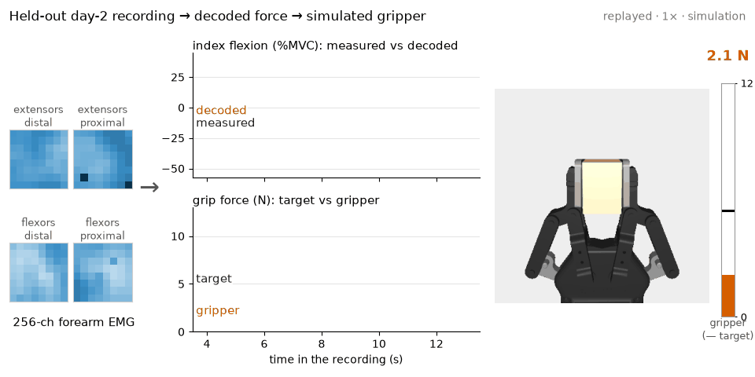
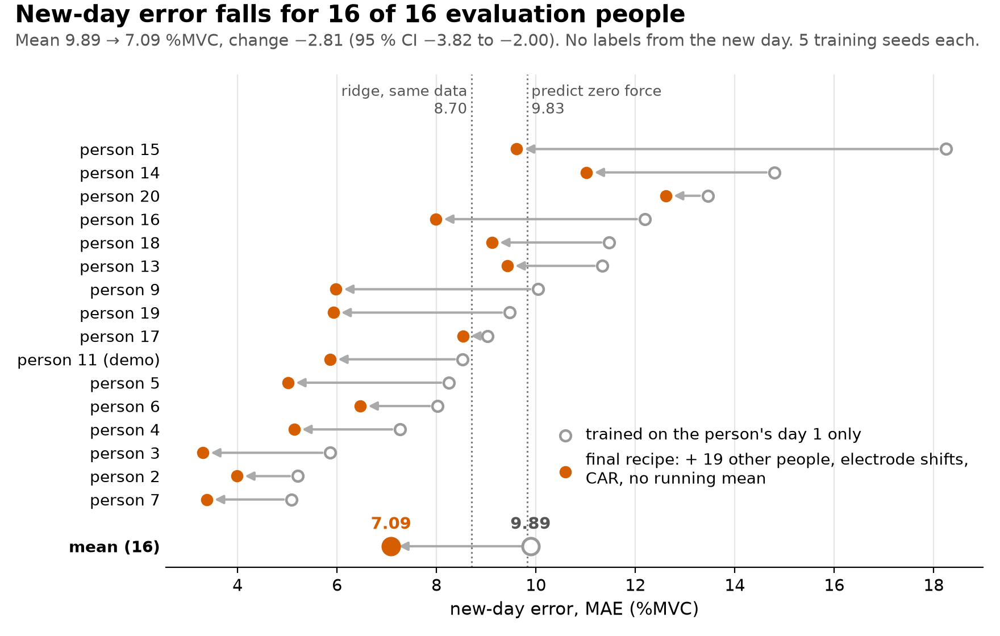
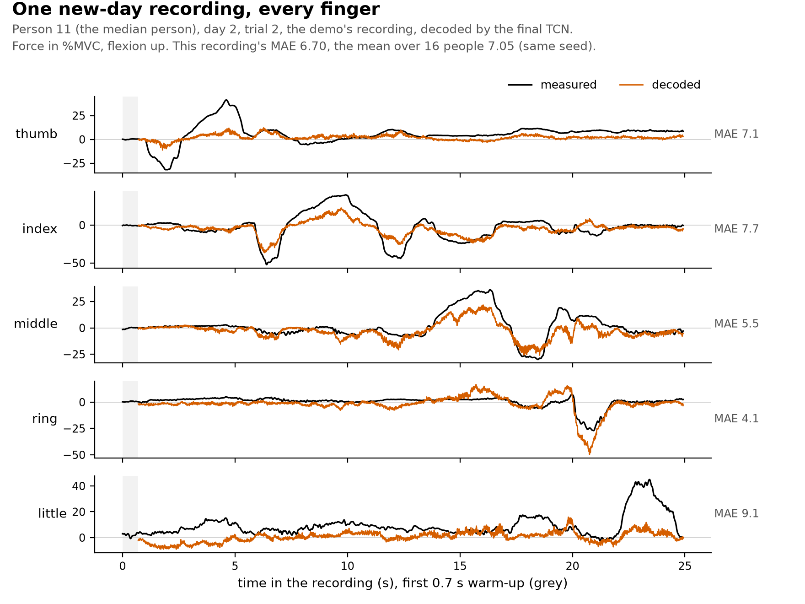

# emg2force

[Experiments](docs/experiments.md) · [Demo video](https://github.com/stelios191/emg2force/releases/latest/download/demo.mp4) · [Dataset](https://physionet.org/content/hd-semg/2.0.0/) · [Trained decoder](assets/decoder.state.pt) · [](https://github.com/stelios191/emg2force/actions/workflows/tests.yml)

A causal decoder of five finger forces from high-density surface electromyography (HD-sEMG): 256 electrodes on the
forearm record the muscles' electrical activity (EMG). The decoder, a temporal convolutional network (TCN), uses only
past EMG, updates every 10 ms and drives a simulated robot gripper.

[](https://github.com/stelios191/emg2force/releases/latest/download/demo.mp4)

*Median person, held-out day, 1× speed: EMG grids, index force, and the gripper following the decoded grip force
(thumb + index).*

The hard case is a new day, after the electrodes are re-applied. Trained on the person's day 1 alone, the decoder is
no better there than predicting zero force: mean absolute error (MAE) 9.89 vs 9.83 %MVC (percent of maximal force).
Three changes bring it to 7.09, with no labels from the new day: training on 19 other people's recordings with simulated
electrode shifts, removing each grid's mean (common average reference, CAR), and dropping an input normalisation that
made a held press fade out.

## Results

MAE in %MVC on 16 evaluation people. Every setting was chosen on 4 other development people, three of them by a rule
set after earlier versions had been scored on the 16 ([how](docs/experiments.md#how-each-setting-was-chosen)).

| Test condition | Zero force | Ridge | LSTM | TCN |
|---|---|---|---|---|
| New day: trained on the person's day 1 and 19 other people, scored on day 2 | 9.83 | 8.70 | 7.45 | **7.09** |
| New person: trained on 19 other people, scored on both days | 9.37 | 8.82 | – | **7.67** |

LSTM = long short-term memory network. New-day TCN and LSTM: 5 seeds. Ridge: same training recordings, with the same share
from the person, no electrode shifts.

- TCN − ridge: −1.62 %MVC (95 % confidence interval −2.06 to −1.12), lower for 15 of 16 people.
- Other people's data does most of the work: a TCN that never saw the person scores 7.99 on the same recordings, and
  adding their day 1 gives 7.05 (one seed each).
- With 75 s of labelled new-day data for fine-tuning, the error on the rest of the day drops from 7.19 to 5.10, lower
  for all 16 people.



The median person's recording in full (flexion plotted up): timing is mostly right, strong presses come out low, a
few are missed (thumb, little finger) and one is overshot (ring, 21 s).



All tables, and the ideas that did not help: [`docs/experiments.md`](docs/experiments.md).

## Real time

| stage | ms |
|---|---|
| band-pass filter (median group delay) | 5.5 |
| framing (mean age of a 10 ms frame's samples) | 5.0 |
| compute per update, paced every 10 ms (one CPU thread, Apple M1) | 2.2 |
| simulated gripper to half of a new force (assumed 30 ms motor lag) | 22 |
| **estimated, sum of the stages above** | **35** |

From an EMG sample to half of the force change at the gripper. Acquisition and transmission are not included. Back
to back, an update takes 0.3 ms. Worst case over 17 787 paced updates: 23.8 ms, 16 of them past the 10 ms deadline
([latency](docs/experiments.md#latency)).

## Pipeline

```
256-ch EMG ─▶ grid mean ─▶ causal band-pass ─▶ log-RMS per channel ─▶ TCN, last 320 ms ─▶ 5 finger forces
 2048 Hz      removed      + 50 Hz notches     every 10 ms                                every 10 ms ─┐
                                                           MuJoCo gripper ◀── force controller ◀───────┘
```

- **Data.** [Hyser](https://physionet.org/content/hd-semg/2.0.0/): 20 people, 2 days, 5 × 25 s of random finger
  presses per day. Four 8 × 8 electrode grids on the forearm (extensors and flexors, distal and proximal) at 2048 Hz,
  finger force at 100 Hz. The EMG clock runs slow against the force clock (the mains hum shows up at about 50.14 Hz,
  not 50), so labels are resampled onto it.
- **Signal.** The grid mean is removed because Hyser records against one distant reference. Band-pass 10-500 Hz.
  log-RMS = log of each channel's root mean square over a 10 ms frame.
- **Model.** Causal TCN over the last 320 ms: 64 channels wide, kernel 2, dilations 1 to 16, 79 k parameters (a 328 kB
  file). L1 loss, 2000 steps. Half of each batch comes from the person and half from 19 others, with the grids
  shifted by up to one electrode.
- **Streaming.** The streaming decoder gives the same output whatever the chunk size, and with the input monitor off
  it matches the offline pipeline to 1e-4 %MVC. The monitor, on by default, replaces dead or noisy electrodes. Export
  to ONNX (Open Neural Network Exchange).
- **Gripper.** A MuJoCo Robotiq 2F-85 squeezing a fixed object: decoded thumb and index flexion set a 1-15 N grip,
  tracked by a proportional-integral force controller. The real gripper is position-controlled, so the model's
  position servo is replaced by a force motor with an assumed 30 ms lag.

## Quick start

Python 3.12 and [uv](https://docs.astral.sh/uv/), macOS or Linux.

```bash
uv sync --frozen
uv run pytest -q                                                            # ~1 min, data tests skip without the dataset
uv run emg2force-benchmark --model assets/decoder.state.pt --out results/latency  # ONNX/PyTorch agreement and timing, ~2 min
curl -LO https://github.com/stelios191/emg2force/releases/latest/download/hyser_sample.zip
unzip -q hyser_sample.zip                                                   # one 25 s Hyser recording, 23 MB
```

```python
import numpy as np

from emg2force.hyser import Hyser
from emg2force.pipeline import load_decoder

ds = Hyser("hyser_sample")  # or the full dataset (see Reproduce)
rec = ds.load(2, 2, 1)  # person 2, day 2, trial 1: a day the trained decoder never saw
decoder = load_decoder("assets/decoder.state.pt")
force = np.array([f for _, f in decoder.push(rec.emg)])  # (frames, 5): thumb..little in %MVC, NaN in the warm-up
label = ds.target(rec, "session").values  # the force recording ends a little before the EMG does
force = force[: len(label)]
print(f"{len(force)} frames, MAE {np.nanmean(np.abs(force - label)):.2f} %MVC")  # 2493 frames, MAE 3.21 %MVC
```

`assets/decoder.state.pt` is person 2's own new-day model (their day 1 plus 19 other people, seed 0). This recording
is one of the easiest: the mean over the 16 people is 7.09.

Input: samples × 256 channels in mV, in the order `Hyser.load` uses. Output: five forces per 10 ms, flexion negative.
Call `decoder.reset()` between recordings. `load_onnx_decoder` runs an exported model without PyTorch.

## Reproduce

```bash
uv run emg2force-download --root ../hyser_raw --subset random mvc   # the full dataset, ~5 GB
uv run python -m experiments.run experiments/configs/final_cross_day_pop_256.yaml --root ../hyser_raw
./reproduce.sh ../hyser_raw   # every computed result, about 7 h on an Apple M1
```

Each run records its config, splits, commit and metrics in `runs/<name>/`, and `experiments.report` writes
`docs/experiments.md` from them. Results are from an Apple GPU (MPS, Metal Performance Shaders). Other hardware differs
slightly.

```
src/emg2force/   hyser (loader), dataset, download, splits, causal (filtering and framing), models (baselines, ridge),
                 tcn (TCN and LSTM), pipeline (streaming decoder, input monitor, ONNX), benchmark, gripper, replay
experiments/     run, metrics, calibration, same_day, hold_test, behaviour, monitor_check, report, demo video and render,
                 configs/
tests/           data and leakage, causality and streaming, models, the released decoder, calibration, end to end
```

## Limitations

- Isometric lab presses on two days, force in %MVC not newtons. Recorded EMG replayed into a simulator, nothing has run
  live.
- Force on resting fingers (MAE at rest 3.7, zero force 2.0) and a noisier output than the real force.
- Strong presses come out low (decoded peak 0.68 of the measured one) and some are missed.
- The 16 test people also scored earlier versions of the recipe, so the final numbers may be optimistic.

## Acknowledgements

Data: Hyser HD-sEMG, Jiang et al. 2023 (PhysioNet, [10.13026/hxan-pe94](https://doi.org/10.13026/hxan-pe94),
[ODC-By 1.0](https://physionet.org/content/hd-semg/view-license/2.0.0/)) and Jiang et al., IEEE TNSRE 2021
([10.1109/TNSRE.2021.3082551](https://doi.org/10.1109/TNSRE.2021.3082551)). PhysioNet: Pollard et al. 2026
([10.1038/s44360-026-00096-z](https://doi.org/10.1038/s44360-026-00096-z)). Gripper: MuJoCo Menagerie (BSD-2-Clause).

## License

Code: MIT ([`LICENSE`](LICENSE)). The dataset and the gripper model keep their own licences.
